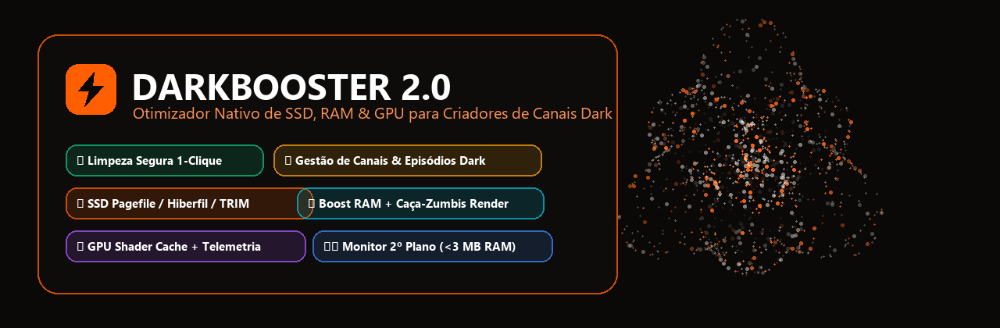
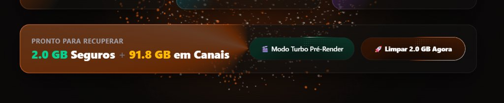
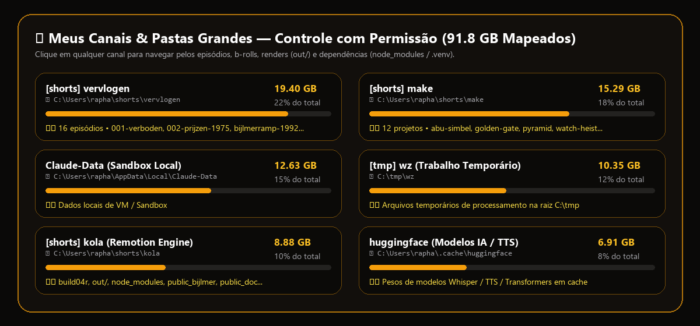
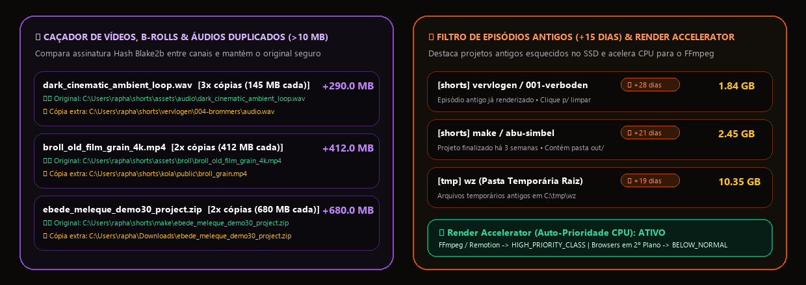
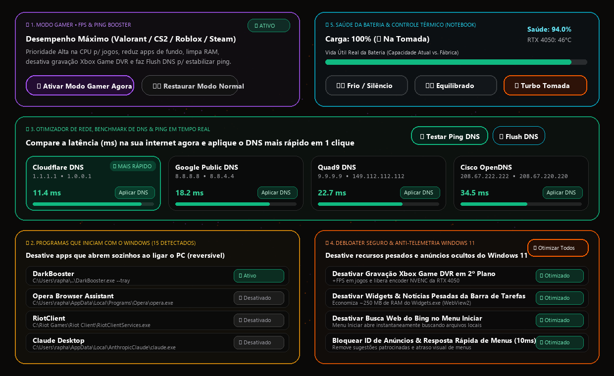
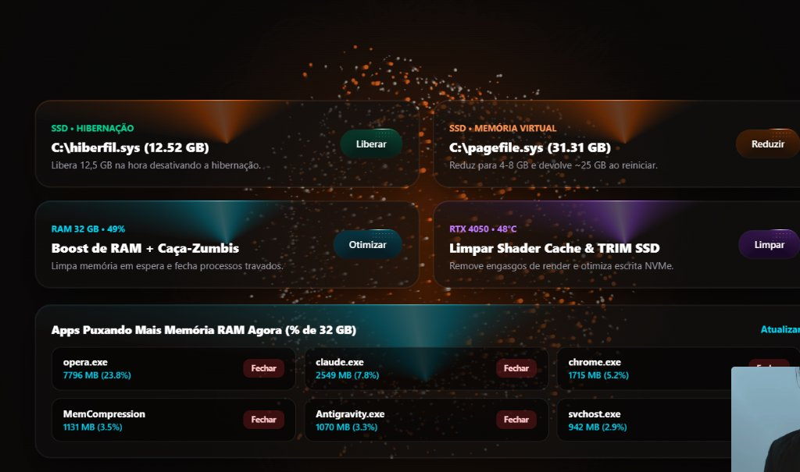
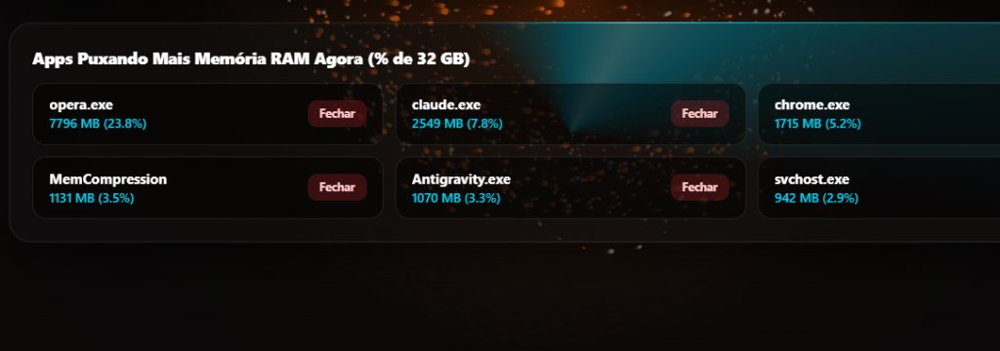

<div align="center">
  
  <h1>⚡ DarkBooster 2.0</h1>
  <p><b>Otimizador Desktop Nativo de SSD, RAM e GPU para Criadores de Canais Dark no YouTube</b></p>
  <p>
    
    
    
    
  </p>
</div>

<p align="center">
  
</p>

---

## 🎯 Por que o DarkBooster foi criado?

Quem produz **vídeos Dark para múltiplos canais no YouTube** (usando ferramentas como **Remotion, FFmpeg, Playwright/Puppeteer, modelos de IA/TTS do HuggingFace, Adobe Premiere/After Effects, CapCut e automações**) sofre com um problema silencioso no Windows:

1. **O SSD é "sugado" invisivelmente (100 GB viram 7 GB livres):** Mesmo apagando pastas normais, o espaço não volta porque fica retido em:
   - Bundles temporários órfãos de renderização (`AppData\Local\Temp\remotion-webpack-bundle-*`, `puppeteer_dev_*`, `Temp\claude`, `etilqs_*`);
   - Bug de cache interno `ListSync` e logs do OneDrive (`AppData\Local\Microsoft\OneDrive\ListSync` — frequentemente +10 GB ocultos);
   - Memória virtual inflada pelo Windows durante renderizações pesadas (`C:\pagefile.sys` chegando a **30–38 GB** mesmo em PCs com 32 GB de RAM) e arquivo de hibernação (`C:\hiberfil.sys` com **12,5 GB**);
   - Shader Caches de GPU (`NVIDIA\DXCache`, `GLCache`, `D3DSCache`) e pesos de modelos de IA (`.cache\huggingface`).
2. **Processos "Zumbis" travam a Memória RAM:** Instâncias headless de `chrome.exe`, `node.exe` e workers de renderização ficam abertas em segundo plano após renders interrompidos, degradando a velocidade das próximas exportações.

O **DarkBooster** resolve isso separando tudo em **2 níveis de segurança** (**Limpeza Segura 1-Clique** vs. **Meus Canais / Pastas que Precisam da Sua Permissão**), com **otimização direta de SSD, RAM e GPU** e um **Monitor de 2º Plano Ultra-Leve (< 3 MB de RAM)**.

---

## 📸 Visão Geral e Interface Gráfica

### 1. Painel Central Direto (Mostra exatamente DE ONDE vai limpar)
<p align="center">
  
</p>

Na tela **`Visão Geral`**, você acompanha em tempo real os **3 medidores circulares (`%`)** de **SSD NVMe**, **Memória RAM (32 GB)** e **GPU (RTX 4050)** sobre o background 3D **`RecursiveErosionBackground`**, além da barra de ação direta que mostra:
- **🟢 Etiquetas clicáveis das pastas que serão limpas agora** (ex: `Lixeira do Windows`, `Temp do Windows`, `Temp Render Remotion`, `Cache OneDrive ListSync`).
- **🟡 Atalhos diretos para as maiores pastas dos seus Canais Dark** que aguardam sua revisão.

---

## 🎬 Destaque Principal: `🟡 Meus Canais` (Gestão Inteligente dos Seus Canais Dark)

<p align="center">
  
</p>

A aba **`Meus Canais`** foi projetada especificamente para proteger o seu trabalho criativo. **Nada nessa aba é apagado automaticamente** — cada ação exige a sua revisão e confirmação explícita.

### Como o DarkBooster identifica os seus Canais Dark automaticamente?
O motor de varredura (`core_scanner.py`) mapeia em tempo real:
1. **Diretório Principal de Canais (`C:\Users\<usuario>\shorts`):**
   - Detecta e separa automaticamente cada canal/projeto em cards individuais (ex: `vervlogen` — **19.40 GB**, `make` — **15.29 GB**, `kola` — **8.88 GB**, `Mundo3D` — **3.78 GB**, `assets` — **2.78 GB**, `weltenerzaehler`, `JustWhy`, `cartoon`).
   - Calcula quantos **`%` do espaço total** cada canal está consumindo no SSD.
2. **Navegação Interna por Episódios e Subpastas (Drill-Down Infinito):**
   - Ao **clicar em cima do card de qualquer canal**, o DarkBooster abre o **Inspetor de Arquivos e Episódios** lá dentro (ex: `001-verboden`, `002-prijzen-1975`, `abu-simbel`, `bijlmerramp-1992`, pasta de exportação `out/`).
   - Você pode clicar em subpastas para navegar cada vez mais fundo (com botão **`⬅️ Voltar`**), abrir qualquer vídeo direto no Windows Explorer (`📂`) ou selecionar apenas os episódios que **já foram publicados no YouTube** para apagar com sua permissão.
3. **Detecção Inteligente de Caches de Build (`node_modules` / `.venv` / `.remotion`):**
   - Dentro de cada canal, o inspetor identifica automaticamente pastas de dependências recriáveis (`node_modules`, `.venv`, `.remotion`, `.next`) e oferece o botão **`🧹 Marcar apenas node_modules / .venv`**, permitindo liberar gigabytes de canais antigos sem apagar o código-fonte nem os roteiros!
4. **Pastas de Trabalho Temporário, IA e Automação:**
   - Mapeia também `C:\tmp` (ex: `C:\tmp\wz` — **10.35 GB**), modelos de IA e voz em `.cache\huggingface` (**6.91 GB**), runtimes em `.cache\codex-runtimes` (**2.62 GB**), navegadores de automação em `AppData\Local\ms-playwright` (**1.68 GB**), sandboxes em `AppData\Local\Claude-Data` (**12.63 GB**) e arquivos grandes esquecidos em `Downloads` e `Videos`.
5. **Seletor Nativo `➕ Adicionar Pasta do PC`:**
   - Guarda projetos de outros canais em outro HD, SSD ou pasta na Área de Trabalho? Basta clicar em **`➕ Adicionar Pasta do PC`** para abrir o seletor nativo do Windows e incluir novas pastas no radar do **Meus Canais**.

### 🔍 Caçador de Arquivos Duplicados (`> 10 MB`), Filtro de Episódios Antigos (`+15 dias`) & Render Accelerator

<p align="center">
  
</p>

- **🔍 Caçador de Vídeos, B-Rolls e Áudios Duplicados (`> 10 MB`):**
  - Compara a assinatura digital (`Hash Blake2b`) em 3 estágios ultrarrápidos entre todas as pastas dos seus canais Dark, `Downloads`, `Videos` e `Music`.
  - Encontra trilhas sonoras, efeitos (SFX), B-rolls e `.zip` repetidos, **protege automaticamente 1 cópia original** (`🛡️ Original mantido`) e permite apagar todas as cópias extras com 1 clique.
- **⏳ Filtro e Etiqueta de Projetos/Episódios Antigos (`+15 dias`):**
  - Destaca automaticamente pastas e episódios sem edição há mais de 15 dias com o selo **`⏳ +X dias`** e oferece os botões **`⏳ Filtrar Antigos (+15d)`** e **`⏳ Marcar Antigos (+15d)`** para limpar vídeos antigos que já foram publicados.
- **🎬 Render Accelerator (Auto-Prioridade de CPU para Renderização):**
  - Quando detecta `ffmpeg.exe`, `Remotion`, `Premiere`, `After Effects`, `CapCut` ou `Blender` renderizando, eleva automaticamente o processo de render para **Prioridade Alta (`HIGH_PRIORITY_CLASS`)** e reduz navegadores em segundo plano (`opera.exe`, `chrome.exe`, `discord.exe`) para `Abaixo do Normal`, acelerando a exportação e restaurando tudo ao normal assim que o render termina.

---

## 🎮 Suite `PC & Gamer` — 5 Módulos de Otimização Geral do Windows

<p align="center">
  
</p>

Além do fluxo para criadores Dark, o **DarkBooster** conta com a aba **`🎮 PC & Gamer`** com 5 ferramentas de desempenho geral para Windows 10/11 e Notebooks Gamer:

1. **🎮 Modo Gamer (FPS & Ping Booster):**
   - Com 1 clique antes de jogar (`Valorant`, `CS2`, `Roblox`, `GTA V`, `Fortnite`, `Apex`, `Minecraft`):
     - Coloca o jogo ativo em **Prioridade Alta de CPU** e reduz apps de fundo;
     - Limpa a memória RAM ociosa em `< 1,5s` (`EmptyWorkingSet`);
     - Desativa a gravação em 2º plano do **Xbox Game DVR** (liberando o encoder NVENC da placa de vídeo);
     - Ativa o plano de energia de **Desempenho Máximo** e limpa o cache de DNS (`ipconfig /flushdns`).
2. **🚀 Gerenciador Visual de Inicialização do Windows (`Startup Manager`):**
   - Lista todos os programas que iniciam sozinhos com o Windows (`HKCU\...\Run` e Pasta de Inicialização).
   - Permite ativar ou desativar qualquer aplicativo com 1 clique (**`🟢 Ativo`** / **`⚪ Desativado`**) fazendo backup reversível da chave original no Registro (`HKCU\Software\DarkBooster\DisabledStartup`).
3. **🌐 Otimizador de Rede, Benchmark de DNS & Ping Test em Tempo Real:**
   - Testa ao vivo a latência (`ms`) da sua conexão para **Cloudflare (`1.1.1.1`)**, **Google (`8.8.8.8`)**, **Quad9 (`9.9.9.9`)** e **OpenDNS (`208.67.222.222`)**.
   - Destaca o servidor **`🏆 MAIS RÁPIDO`** no momento e aplica o DNS escolhido na placa de rede com 1 clique, além de oferecer **`🧹 Flush DNS`** e **`🔄 Restaurar Automático (DHCP)`**.
4. **🧹 Debloater Seguro & Anti-Telemetria do Windows 11:**
   - 5 otimizações seguras e reversíveis (individuais ou via botão **`🚀 Otimizar Todos`**):
     - Desativar Gravação Xbox Game DVR em 2º Plano;
     - Desativar Widgets & Notícias Pesadas da Barra de Tarefas (economiza ~250 MB de RAM do `Widgets.exe`);
     - Desativar Busca Web do Bing no Menu Iniciar (abre o Menu Iniciar instantaneamente);
     - Bloquear ID de Anúncios e Sugestões Patrocinadas da Microsoft;
     - Resposta Instantânea de Menus (`MenuShowDelay = 10ms`).
5. **🔋 Saúde da Bateria & Controle Térmico do Notebook:**
   - Calcula o **desgaste real da bateria via WMI** (`Capacidade Atual vs. Capacidade de Fábrica em %`), mostra status de tomada/bateria, temperatura da GPU (`°C`) e permite alternar em 1 clique entre **`❄️ Frio / Silêncio`**, **`⚖️ Equilibrado`** e **`🔥 Turbo Tomada`**.

---

## ⚡ Otimização de Hardware: `SSD • RAM • GPU`

<p align="center">
  
</p>

Todos os cards da aba **`SSD • RAM • GPU`** também são **clicáveis** para você inspecionar os arquivos reais dentro do sistema:

### 💾 1. Melhoria e Recuperação Profunda de SSD
- **❄️ `C:\hiberfil.sys` (Desativar Hibernação — Libera ~12,52 GB na hora):** Remove o arquivo oculto de hibernação do Windows com 1 clique via `powercfg -h off`.
- **📉 `C:\pagefile.sys` (Desinchar Memória Virtual — Libera ~25 a 29 GB):** Reduz o arquivo de paginação inflado por renderizações (de 31–38 GB para um limite saudável de 4–8 GB em máquinas com 32 GB de RAM).
- **☁️ Liberar Cache Local do OneDrive:** Executa `attrib +U -P` para liberar o espaço físico no SSD de arquivos sincronizados mantendo-os seguros na nuvem.
- **⚡ Forçar TRIM no SSD NVMe:** Executa `Optimize-Volume -DriveLetter C -ReTrim` para restaurar a velocidade máxima de gravação do SSD após exportar vídeos pesados.

### 🧠 2. Boost de Memória RAM + Caça-Zumbis (`> 1000 MB` exibido automaticamente em `GB`)
<p align="center">
  
</p>

- **🧠 Boost de RAM Nativo (`EmptyWorkingSet`):** Chama diretamente a API Win32 `psapi.EmptyWorkingSet` em todos os processos abertos para recolher páginas de memória ociosas sem fechar seus aplicativos.
- **🎬 Modo Turbo Pré-Render (1-Clique antes de renderizar):**
  1. Mata workers headless órfãos (`chrome-headless-shell.exe`, `node.exe --headless`, `puppeteer_dev_*`) que ficaram presos de renderizações anteriores;
  2. Limpa os bundles temporários `remotion-webpack-bundle-*` e `Temp\claude` no SSD;
  3. Executa o flush completo de RAM (`EmptyWorkingSet`) para entregar o máximo dos seus 32 GB livres para o renderizador.
- **📊 Lista Visual de Apps na RAM (Clicável):**
  - Qualquer aplicativo consumindo mais de `1000 MB` é exibido automaticamente em **`GB`** (ex: `opera.exe: 7.60 GB (23.8%)`, `claude.exe: 2.50 GB (7.8%)`, `chrome.exe: 1.60 GB (5.0%)`).
  - **Clicar em qualquer aplicativo** abre o inspetor mostrando o caminho exato do executável (`.exe`) no disco, cada instância/PID aberta e os botões **`📂 Ver Arquivo`** e **`❌ Fechar`**.

### 🎮 3. Manutenção de GPU (NVIDIA RTX / AMD Radeon / DirectX)
- **Telemetria em Tempo Real:** Monitora temperatura (`°C`), uso do chip gráfico (`%`) e consumo de VRAM dedicada via `nvidia-smi`.
- **Limpeza de Shader Cache (2,5+ GB):** Limpa `NVIDIA\DXCache`, `GLCache`, `NV_Cache`, `AMD\DxCache` e `D3DSCache` para recuperar espaço no SSD e eliminar engasgos (*stuttering*) na preview e codificação NVENC.

---

## 🟢 `Limpeza Segura (1-Clique)` — O que ela apaga sem risco?

A aba **`Limpeza Segura`** reúne tudo que pode ser apagado a qualquer momento **sem risco de perder projetos, vídeos ou senhas salvas**:

| Categoria Segura | Caminho no Sistema | O que é limpo? |
| :--- | :--- | :--- |
| **OneDrive (ListSync & Logs)** | `AppData\Local\Microsoft\OneDrive\ListSync` | Cache SQLite interno e logs que incham ocultamente (+10 GB). Não apaga seus arquivos pessoais. |
| **Temp Render (Remotion / Puppeteer)** | `AppData\Local\Temp\remotion-*` e `puppeteer_*` | Bundles webpack temporários, perfis Chromium headless e bancos `etilqs_*`. |
| **Temp Claude** | `AppData\Local\Temp\claude` | Arquivos temporários de execução acumulados em `Temp\claude`. |
| **Temp do Windows** | `AppData\Local\Temp` e `C:\Windows\Temp` | Arquivos temporários destravados (arquivos em uso no momento são ignorados com segurança). |
| **Shader Cache GPU** | `AppData\Local\NVIDIA\DXCache`, `GLCache`, `D3DSCache` | Shaders antigos compilados pela placa de vídeo. |
| **Lixeira do Windows** | `C:\$Recycle.Bin` | Esvaziamento direto via API `SHEmptyRecycleBinW`. |
| **Cache de Mídia Chrome & Opera** | `User Data\Default\Cache`, `Code Cache`, `GPUCache` | Apenas cache de imagens/vídeos. **Preserva 100% dos seus logins, cookies e senhas.** |
| **Caches de Apps Dark & Pacotes** | `darkplanner-updater`, `Adobe Media Cache`, `npm-cache`, `pnpm-cache`, `pip`, `uv` | Instaladores antigos em cache de download (não desinstala bibliotecas dos seus projetos). |

---

## 🪶 Arquitetura Nativa & Monitor de 2º Plano (`< 3 MB de RAM`)

- **Janela Desktop Nativa (`pywebview` + `.NET WinForms` + Ícone na Barra de Tarefas):**
  - Barra superior arrastável personalizada com indicador **`🛡️ Acesso Admin Total`**, atalhos diretos para ferramentas do Windows (**`📊 TaskMgr`**, **`💽 Partições SSD`**, **`🎮 GPU Windows`**, **`⚡ Energia`**) e controles de janela nativos.
- **Zero Consumo durante a Renderização:**
  - Ao clicar no **`✕`** ou em **`2º Plano`**, o processo gráfico da janela é encerrado por completo (liberando 100% da memória de interface) e apenas o vigia nativo permanece na **Bandeja do Sistema** (perto do relógio do Windows), aplicando `EmptyWorkingSet` e `SetProcessWorkingSetSize` em si mesmo para consumir **apenas ~1,5 MB a 3 MB de RAM e 0,0% de CPU**.
  - **Modo Zero Impacto:** Detecta automaticamente quando `ffmpeg.exe`, `Remotion`, `Premiere`, `After Effects`, `CapCut` ou `Blender` estão renderizando e pausa qualquer leitura de disco até o término do render.

---

## 🚀 Como Executar e Compilar

### 1. Executando direto pelo Executável Nativo
Basta dar **2 cliques** em **`DarkBooster.exe`** (na pasta do projeto ou na Área de Trabalho) ou em **`Iniciar_DarkStudio_Optimizer.bat`**.

### 2. Ambiente de Desenvolvimento (Python + React/Vite)
```bash
# 1. Instalar dependências Python
python -m pip install psutil pystray pillow pywebview

# 2. Instalar dependências Frontend e compilar interface
pnpm install
pnpm run build

# 3. Iniciar o DarkBooster Desktop Nativo
python app.py
```

---

## 📁 Estrutura do Projeto

```text
DarkBooster/
├── DarkBooster.exe                  # Executável nativo Windows com ícone 256px na Barra de Tarefas
├── darkbooster.ico                  # Ícone multi-resolução (16px a 256px)
├── app.py                           # Controlador Desktop Nativo (PyWebView + API Local + System Tray)
├── core_scanner.py                  # Motor de varredura rápida (Limpeza Segura + Meus Canais + Inspetor)
├── core_optimizer.py                # Motor Win32 PSAPI (RAM EmptyWorkingSet, GPU nvidia-smi, SSD Pagefile/Hiberfil/TRIM)
├── assets/                          # Logos, banners e screenshots reais da aplicação
└── src/
    ├── App.tsx                      # Interface Visual com Medidores Radiais %, Inspetor de Arquivos e Barra Nativa
    ├── index.css                    # Estilo Glassmorphic Gleam Panel
    └── components/ui/
        ├── recursive-erosion.tsx    # Background 3D Recursive Erosion Particle Sphere
        └── shiny-button.tsx         # Botões e Menus com borda cônica animada (CSS Houdini @property)
```
